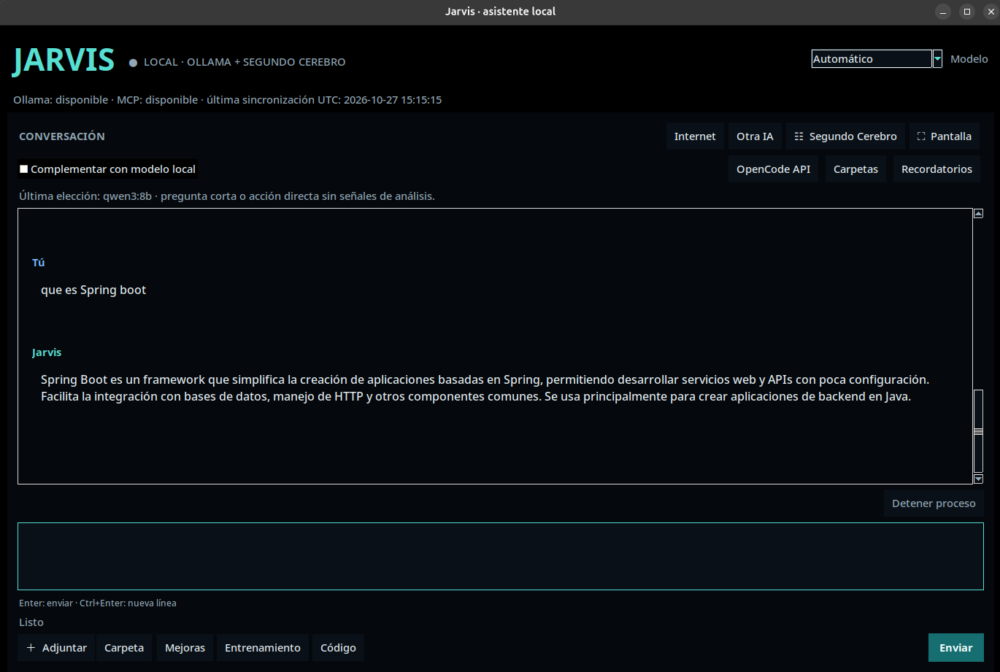

# Jarvis

Asistente local en español desarrollado en Python, con interfaz gráfica y modo de terminal. Utiliza Ollama para conversar con modelos locales y ofrece herramientas para trabajar con archivos, documentos y tareas.


## Vista previa



## Funciones presentes en el código

- Chat gráfico con Tkinter y acceso desde terminal.
- Cliente de Ollama para modelos locales.
- Lectura de documentos y referencias a archivos adjuntos.
- Propuestas de cambios de archivos con confirmación.
- Tareas, recordatorios y herramientas de diagnóstico.
- Integración con un servicio independiente llamado Segundo Cerebro.

La integración con Segundo Cerebro requiere instalar y configurar ese proyecto por separado. Este repositorio no lo incluye ni explica su instalación.


## Requisitos

- Linux: la instalación original utiliza Ubuntu/GNOME; otros sistemas no están verificados.
- Python 3: comprobado con 3.14.4. La versión mínima compatible todavía está por determinar.
- Tkinter para la ventana gráfica.
- Ollama instalado y un modelo local disponible.
- Los complementos de `requirements.txt` para lectura documental y métricas.

## Preparación local

Desde una terminal abierta en la carpeta de este proyecto:

```bash
python3 -m venv .venv
source .venv/bin/activate
python -m pip install -r requirements.txt
```


La interfaz gráfica necesita Tkinter. La lectura de PDF mediante Poppler requiere las herramientas `pdfinfo` y `pdftotext`, instaladas por separado.

## Inicio

Es importante definir `JARVIS_DIR` para que esta copia utilice su propia carpeta:

```bash
export JARVIS_DIR="$PWD"
python herramientas/interfaz_grafica.py
```

Para el modo de terminal:

```bash
export JARVIS_DIR="$PWD"
python herramientas/jarvis_agente.py
```

### Elegir un modelo instalado

El valor inicial `jarvis-deepseek:8b` es un alias personalizado; no se incluye ni se descarga automáticamente. Para una primera prueba con un modelo existente:

1. Comprueba que Ollama esté instalado y que tengas un modelo local descargado.
2. Abre Jarvis como se indica arriba.
3. Escribe `/modelos` para ver los nombres disponibles.
4. Escribe `/modelo NOMBRE`, sustituyendo NOMBRE por uno de esa lista. En esta comprobación se usó `/modelo qwen2.5-coder:1.5b`.
5. Escribe `/contexto 4096` para la prueba de contexto pequeño.
6. Pregunta `Solo texto. Responde únicamente con el resultado numérico de 2 + 2.`.

Si todavía no tienes modelos, debes obtener uno mediante Ollama antes de este paso.

En Jarvis, `/ayuda` muestra los comandos y `/diagnostico` permite consultar las conexiones. No uses el proyecto con documentos privados hasta revisar su configuración y los servicios habilitados.

## Pruebas

El proyecto incluye archivos `prueba_*.py` y un ejecutor con carpetas temporales. Algunas pruebas necesitan herramientas del sistema o una sesión gráfica. El aislamiento nativo del ejecutor requiere un kernel Linux compatible con Landlock.

```bash
python herramientas/ejecutar_pruebas.py --procesos 1
```

## Estructura

- `herramientas/`: programa, pruebas y recursos base.
- `herramientas/modelos/`: definición de modelo para Ollama.
- `herramientas/terceros/`: componentes incluidos con sus licencias y procedencia.
- `requirements.txt`: complementos de Python.

## Licencia

El código propio de Jarvis se distribuye bajo la licencia [GNU GPLv3](LICENSE). Los componentes de terceros conservan sus respectivas licencias y avisos de autoría.

## Propuestas de mejora

¿Corregiste un error o añadiste algo útil? Te invito a compartirlo mediante una pull request.

Explica qué cambiaste, por qué y cómo lo probaste. Así podré revisar tu propuesta y valorar su incorporación a Jarvis.

También puedes abrir un issue para comunicar errores o proponer ideas. No incluyas contraseñas, claves ni datos personales.

Compartir una propuesta con este repositorio es voluntario; la licencia no obliga a avisarme personalmente de cada modificación.
